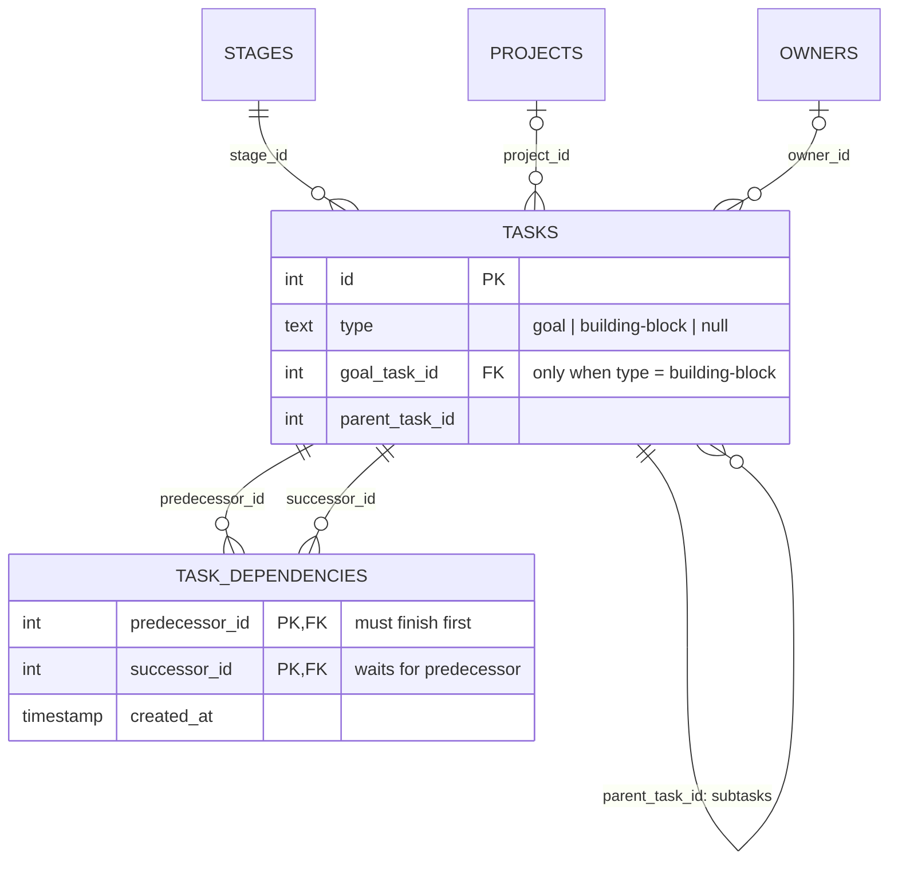

# Architecture

## System Overview

kanban-local1 is a local-first Kanban board application built as a single-process Express + Vite + React monolith backed by PostgreSQL. It serves both API and client on a single port (default 5000).

```
┌─────────────────────────────────────────────────────────┐
│  Browser (port 5000)                                    │
│  ┌──────────────┐  ┌─────────────┐  ┌───────────────┐  │
│  │  Dashboard    │  │  Admin      │  │  Archive      │  │
│  │  (KanbanBoard)│  │  (Stages/   │  │  (Archived    │  │
│  │              │  │   SubStages) │  │   Tasks)      │  │
│  └──────┬───────┘  └──────┬──────┘  └──────┬────────┘  │
│         └──────────────────┼───────────────┘            │
│                    React Query                          │
│               apiRequest → /api/*                       │
└────────────────────────────┬────────────────────────────┘
                             │ HTTP
┌────────────────────────────┴────────────────────────────┐
│  Express (server/index.ts)                              │
│  ├── JSON body parser                                   │
│  ├── Request logger middleware                          │
│  ├── API routes (server/routes.ts)                      │
│  │   ├── Zod validation via shared/routes.ts contracts  │
│  │   └── parseIdParam for route param validation        │
│  ├── Error-handling middleware (server/errors.ts)        │
│  ├── DatabaseStorage (server/storage.ts)                │
│  │   └── IStorage interface                             │
│  └── Vite middleware (dev) or static serve (prod)       │
└────────────────────────────┬────────────────────────────┘
                             │ pg
┌────────────────────────────┴────────────────────────────┐
│  PostgreSQL                                             │
│  Tables: projects, owners, stages, sub_stages, tasks    │
│  Schema: shared/schema.ts (Drizzle)                     │
└─────────────────────────────────────────────────────────┘
```

---

## Module Structure

The codebase is organised into three top-level source directories plus a shared module that is imported by both client and server.

```
kanban-local1/
├── client/src/          # React frontend (Vite)
├── server/              # Express API server
└── shared/              # Code shared between client and server
```

### Path Aliases (tsconfig + Vite)

| Alias | Resolves to |
|---|---|
| `@/*` | `client/src/*` |
| `@shared/*` | `shared/*` |

---

## Shared Modules (`shared/`)

Shared modules are the single source of truth for types, constants, API contracts, and logging. Both client and server import from here — nothing is redefined on either side. Seven modules: `schema.ts` (Drizzle tables, Zod schemas, TS types), `routes.ts` (declarative API contracts), `constants.ts` (enums, labels, helpers), `api-types.ts` (error/response types), `export.ts` (export envelope + builder, used by `GET /api/export` and the client download), `project-scope.ts` (the `all` / `none` / `<id>` project-scope tokens the header, the URL and `?projectId=` all read and write), and `logger.ts` (log-level-gated logger — all application logging routes through this, no direct `console.log`).

### Export envelope

`GET /api/export` returns a single JSON object (never a bare array) built by `buildExportBundle` in `shared/export.ts`:

| Key | Notes |
|---|---|
| `formatVersion` | Bump only on breaking envelope changes |
| `generator`, `exportedAt` | Provenance |
| `scope` | `{ includeArchived, projectIds }`; `projectIds` is `null` for an unscoped export, otherwise the project ids the tasks were filtered to |
| `counts` | `tasks`, `stages`, `subStages`, `projects` |
| `stages`, `subStages`, `tasks` | Payload — makes the export self-contained |
| `projects` | Every project, even for a scoped export, so the file resolves each task's `projectId` |

Query params: `includeArchived=true|false` (default `false`) and `projectId=<id>`, which scopes the exported tasks to one project; a non-numeric value is a 400. Import accepts both this envelope and legacy bare-array files via `tasksFromExportPayload`.

See [COMPONENT_INDEX.md — Shared Modules](COMPONENT_INDEX.md#shared-modules-shared) for the full export listing.

---

## Client Architecture (`client/src/`)

### Component Tree

```
App
├── QueryClientProvider
│   └── ErrorBoundary
│       └── TooltipProvider
│           ├── Toaster
│           └── ProjectScopeProvider (project scope: localStorage + ?project=)
│             └── Router (wouter)
│               ├── Dashboard (/)
│               │   ├── DashboardHeader
│               │   │   ├── ProjectSelector (hidden until a project exists)
│               │   │   ├── FocusModeToggle
│               │   │   └── MoreActionsMenu
│               │   ├── DashboardContent
│               │   │   └── KanbanBoard
│               │   │       ├── KanbanColumnContent
│               │   │       │   ├── TaskColumn
│               │   │       │   │   ├── TaskCard / TaskCardSummary
│               │   │       │   │   └── DayPlanSubStage
│               │   │       │   └── ArchiveZone
│               │   │       └── KanbanDragOverlay
│               │   ├── DashboardBottomNav
│               │   ├── CreateTaskDialog (ProjectSelect)
│               │   └── EditTaskDialog
│               │       ├── EditTaskFormFields (ProjectSelect)
│               │       └── EditTaskDialogActions
│               ├── Admin (/admin)
│               │   ├── AdminHeader
│               │   ├── ProjectSection
│               │   ├── StageSection
│               │   └── SubStageSection
│               ├── Archive (/archive)
│               └── NotFound (fallback)
```

All API calls go through the `apiRequest<T>` typed fetch wrapper in `lib/api.ts`. 7 shared hooks in `hooks/` plus 2 page-local hooks co-located with Dashboard. 45 vendored shadcn/ui primitives in `components/ui/` (treated as library code).

See [COMPONENT_INDEX.md](COMPONENT_INDEX.md) for the full breakdown of every component, hook, API layer module, and page with exports and responsibilities.

---

## Server Architecture (`server/`)

10 modules: `index.ts` (bootstrap), `app.ts` (`createApp()` for tests), `routes.ts` (API handlers with Zod validation), `errors.ts` (centralised error handling — see [Error Handling](#error-handling) below), `utils.ts` (`parseIdParam`), `storage.ts` (`IStorage` interface + `DatabaseStorage`), `db.ts` (pg pool + Drizzle), `seed.ts`, `static.ts` (production serving), `vite.ts` (dev HMR).

See [COMPONENT_INDEX.md — Server Modules](COMPONENT_INDEX.md#server-modules-server) for the full export listing.

### Request Lifecycle

1. Client hook (e.g. `useTasks(scope)`) calls `apiGet("/api/tasks")`, with `?projectId=` appended when the board is scoped to a project.
2. Express route handler in `server/routes.ts` receives the request.
3. Route params are validated via `parseIdParam`. Request bodies are validated against Zod schemas from `shared/routes.ts`.
4. `DatabaseStorage` method executes the Drizzle query against PostgreSQL.
5. Response is returned as JSON. On error, the `errorHandler` middleware catches it and returns a consistent `{ error, status, details? }` shape.
6. React Query caches the response and re-renders the component.

---

## Error Handling

Error handling is centralised on both client and server.

### Server

| Component | Location | Role |
|---|---|---|
| `AppError` | `server/errors.ts` | Custom error class carrying `statusCode`, `message`, and optional `details`. Throw from any route handler to produce a structured error response |
| `errorHandler` | `server/errors.ts` | Express error-handling middleware (4-param signature). Catches all errors that reach the middleware stack. `AppError` instances produce their status code; other errors produce 500. Stack traces are only included in non-production |
| `asyncHandler` | `server/errors.ts` | Wraps async route handlers so rejected promises are forwarded to `errorHandler` via `next()` (Express 4 does not catch async rejections automatically) |
| `parseIdParam` | `server/utils.ts` | Validates numeric route params. Returns the parsed number or sends a 400 JSON error and returns `null` |
| Registration | `server/app.ts`, `server/index.ts` | `errorHandler` is registered after all routes via `app.use(errorHandler)` |

**Server error response shape** (defined in `shared/api-types.ts`):

```typescript
interface ApiErrorResponse {
  error: string;
  status: number;
  details?: unknown;
}
```

### Client

| Component | Location | Role |
|---|---|---|
| `ErrorBoundary` | `components/ErrorBoundary.tsx` | React class component wrapping the entire app (below `QueryClientProvider`, above `TooltipProvider`). Catches uncaught render errors, logs via `logger`, and shows a fallback UI with Dismiss and Reload actions |
| `ApiError` | `lib/api.ts` | Error class thrown by `apiRequest` on non-OK HTTP responses. Carries `status`, `statusText`, and parsed error `body` |
| Network errors | `lib/api.ts` | `apiRequest` detects `TypeError` from `fetch` failures and throws a descriptive network error message |

**Error flow:**

- **Render errors** → `ErrorBoundary` → fallback UI
- **API errors** → `apiRequest` throws `ApiError` → React Query's `onError` / component error states
- **Route handler errors** → per-handler try/catch or bubbles to `errorHandler` middleware → consistent JSON response

---

## Development vs Production

| Concern | Development | Production |
|---|---|---|
| Client serving | Vite dev server with HMR (middleware mode) | Static files from `dist/public/` with SPA fallback |
| Bundling | None (Vite transforms on the fly) | Client: Vite build. Server: esbuild → `dist/index.cjs` |
| Logging | `logger.debug` enabled | `logger.debug` suppressed (min level: `info`) |
| Error details | Stack traces included in error responses | Stack traces omitted; generic "Internal Server Error" message |
| Server start | `tsx server/index.ts` | `node dist/index.cjs` |

---

## Database Schema

The board tables defined in `shared/schema.ts` (the Gmail pipeline adds `gmail_watch_cursor` and `inbound_email_processing`):

### projects

A project is a set of tasks related to a common goal. It scopes which tasks the board shows and never changes the stages (filter, don't fork — see `docs/epics/EPIC-01-project-layer.md`).

| Column | Type | Notes |
|---|---|---|
| id | serial PK | |
| name | text | Not null; unique case-insensitively at the API (409) |
| key | text | Optional short code shown on chips, upper-cased |
| color | text | Hex colour, nullable |
| archived | boolean | Default false; archived projects keep their tasks but leave the pickers |
| order | integer | Default 0 |
| created_at | timestamp | Default now |

### owners

A person work can be assigned to (`docs/epics/EPIC-06-owner-as-entity.md`). An owner is a label with an identity — one row, renameable once, referenced by many tasks — not an account: no email, no credentials, no membership. Authentication stays EPIC-02's.

| Column | Type | Notes |
|---|---|---|
| id | serial PK | |
| name | text | Not null; unique case-insensitively in the database (`owners_name_lower_uniq`) as well as at the API (409) |
| key | text | Optional short code shown on a chip when the name is longer than the card's budget, upper-cased |
| color | text | Hex colour, nullable |
| archived | boolean | Default false; archived owners keep their assignments but leave the pickers |
| order | integer | Default 0 |
| created_at | timestamp | Default now |

### stages

| Column | Type | Notes |
|---|---|---|
| id | serial PK | |
| name | text | Not null |
| order | integer | Display order |
| color | text | Hex colour, nullable |
| created_at | timestamp | Default now |

### sub_stages

| Column | Type | Notes |
|---|---|---|
| id | serial PK | |
| stage_id | integer FK → stages | Cascade delete |
| name | text | |
| tag | text | Unique identifier, e.g. `"day-plan-am"`. Not read for a lane with an `owner_id` |
| owner_id | integer FK → owners | Nullable. Set = this is that owner's lane, holding exactly the tasks in its stage they own; null = a tag lane, matched against `tasks.tags` as before. `ON DELETE SET NULL`; at most one lane per owner per stage (`sub_stages_stage_owner_uniq`) |
| bg_class | text | Legacy: once a Tailwind class for the lane tint; no longer read, blank on new rows. Drop in a later migration |
| opacity | integer | 0–100, the lane's shade (Admin "Shade" slider) |
| order | integer | Display order |
| created_at | timestamp | |

### tasks

| Column | Type | Notes |
|---|---|---|
| id | serial PK | |
| title | text | Not null |
| description | text | Nullable |
| stage_id | integer FK → stages | |
| project_id | integer FK → projects | Nullable — null is "no project". `ON DELETE SET NULL`; indexed with `stage_id` |
| archived | boolean | Default false |
| status | text | `backlog` / `in_progress` / `done` / `abandoned` |
| priority | text | `low` / `normal` / `high` / `critical` |
| type | text | Nullable (unset). `goal` or `building-block`; a `CHECK` enforces the two values |
| goal_task_id | integer FK → tasks | Nullable. The `goal` a `building-block` contributes to. `ON DELETE SET NULL`; indexed. See **Goal link** below |
| effort | integer | 1–5, nullable |
| due_date | timestamp | Nullable |
| tags | jsonb | `string[]` |
| parent_task_id | integer FK → tasks | Self-referential (subtasks) |
| recurrence | text | `none` / `daily` / `weekly` / `monthly` |
| history | jsonb | `TaskHistoryEntry[]` (status change log) |
| owner_id | integer FK → owners | Nullable — null is "Unassigned". `ON DELETE SET NULL`; indexed with `stage_id` |
| owner | text | **Read-only mirror** of `owners.name`, kept in step by two triggers so `GET /api/export` and the daily-briefing agent read the field they read before EPIC-06. A task write sets `owner_id`; EPIC-06 story OWN-10 drops this column and its triggers |
| updated_at | timestamp | |
| created_at | timestamp | |

#### Goal link and dependencies at a glance

Three different relationships between tasks, deliberately in three different places so none is overloaded:

| Question | Where | Cardinality |
|---|---|---|
| Which goal does this block contribute to? (*membership*) | `tasks.goal_task_id` | block → 0..1 goal; goal → 0..n blocks |
| What is this a subtask of? (*decomposition*) | `tasks.parent_task_id` | task → 0..1 parent (no DB FK yet, see EPIC-05 OQ-6) |
| What must finish before this? (*ordering*) | `task_dependencies` | many-to-many |



**Goal link** (migration `0017_task_goal_link.sql`; `shared/task-goal.ts`). A block has 0 or 1 goal, a goal has 0..n blocks, and a block with no goal is an unassigned orphan. All of this is enforced in the database as well as the API:

- `goal_task_id` may be set only when `type = 'building-block'` (`CHECK`), must point at a task whose `type = 'goal'` (trigger), and cannot point at the task itself (`CHECK`).
- Goals do not nest, so the goal graph is two levels deep and cannot loop.
- A goal that still has blocks cannot be retyped (trigger); reassign them first.
- Deleting a goal forever sets its blocks' `goal_task_id` to null. Binning keeps the link.
- The API clears `goal_task_id` when a task is changed away from `building-block`.
- **Project consistency** (migration `0019_goal_project_consistency.sql`): when a goal has a `project_id`, its blocks must have the same one; a goal with no project is cross-cutting and takes blocks from any project. Enforced both ways: linking or moving a block, and moving a goal into a project while blocks sit elsewhere. Rows written before 0019 are checked the next time they are touched. The task form offers only goals that fit the block's project.

### task_dependencies

Predecessor / successor, a **many-to-many** on `tasks` (migration `0018_task_dependencies.sql`; `shared/task-dependencies.ts`). A task may have any number of predecessors and any number of successors.

| Column | Type | Notes |
|---|---|---|
| predecessor_id | integer FK → tasks | Must finish before `successor_id`. `ON DELETE CASCADE` |
| successor_id | integer FK → tasks | Waits for `predecessor_id`. `ON DELETE CASCADE`; indexed (the primary key serves lookups by predecessor) |
| created_at | timestamp | |

Primary key `(predecessor_id, successor_id)`. One row is **one edge in one direction**: "successor" is not a second stored fact, it is the same row read from the other end (a task's successors are the rows where it is `predecessor_id`). Storing both directions would let two rows disagree about one relation. Timing judgements (late, on time) are derived at read time and never stored.

- Two distinct tasks (`CHECK`); no duplicate edge (primary key).
- **Acyclic**: a trigger rejects an edge whose predecessor is already downstream of its successor, so a critical path always exists.
- **Same project** (migration `0020_dependency_same_project.sql`): an edge joins two tasks in the same project, "no project" counting as a project of its own. Enforced both ways: adding an edge across projects is refused, and so is moving a task into another project while an edge still links it to a task left behind. The task form lists only same-project tasks, and when a task's project changes it drops the links that no longer fit (and says so). Edges written before 0020 are checked when either task's project next changes.
- Deleting a task forever removes its edges. Binning or archiving keeps them; whether a binned or done predecessor counts is a read-time judgement.

API: `GET /api/task-dependencies` lists every edge. `POST /api/tasks` and `PATCH /api/tasks/:id` accept optional `predecessorIds` and/or `successorIds`; a side that is present **replaces** that side's edges, a side left out is untouched, and a rule break answers 400 with the reason. `GET /api/export` carries the edges between exported tasks as an optional `dependencies` array (no `EXPORT_FORMAT_VERSION` bump). The task form edits both sides under Predecessors / Successors. Import restores neither `goal_task_id` nor edges: ids are remapped on import.

Reports: a **critical path** weights each task (effort or duration) and finds the longest path through this DAG. A **project view** groups tasks by `goal_task_id` and lays each group's blocks out along the edges.

#### Project and goal views

`/projects/:projectId` (`none` for tasks with no project) lists the project's goals with progress and days left; `/goals/:goalId` shows one goal's building-blocks in dependency order, with a critical path and a Gantt chart on demand. The board header's target button opens the view for the scoped project.

Scheduling is `shared/schedule.ts` (critical path method: forward and backward pass, slack) fed by `shared/goal-view.ts`. A task has no duration of its own, so **effort counts as days** (no effort = 1 day, finished tasks = 0) and the plan starts today. Only dependencies between the goal's own tasks are used. Nothing is stored: the schedule is derived each time, so it cannot go stale when a task moves.

#### AI assistant: "Make this a goal"

The task form's **Make this a goal** button sends a saved `goal` task (title, description, metadata, existing building-blocks) to OpenAI and shows the suggested goal wording and building-blocks for editing; nothing is stored until the user saves one row, the ticked rows or all of them. The form refuses, by toast and before any request, a task with unsaved changes or one that is not of type Goal; the server repeats the type check.

- Prompt: `shared/goal-plan.ts` (`GOAL_PLAN_SYSTEM_PROMPT` + `buildGoalPlanUserPrompt`). The output is pinned by OpenAI structured output to `{ goal: {title, description}, subtasks: [{key, title, description, effort 1–5, dependsOn}] }`; `normaliseGoalPlan` keeps only dependencies on earlier suggestions or existing blocks, so a plan is acyclic as suggested.
- `POST /api/tasks/:id/goal-plan` asks (nothing saved). Body `{ how, whoWhere }`, the dialog's two checkboxes: **how** adds `HOW_INSTRUCTIONS` (plain explanations, a direct step-by-step breakdown, up to 20 sub-tasks); **whoWhere** adds `WHO_WHERE_INSTRUCTIONS` and OpenAI's `web_search` tool, filling each sub-task's `contacts` (name, purpose, phone, email, website, address, source URL; never invented). Both may be on; it is still one Responses API call (OpenAI SDK, `zodTextFormat`). Saved contacts are appended to the block's description as a Markdown "Who and where" section. `POST /api/tasks/:id/goal-plan/apply` saves in one transaction: optional goal wording, new building-blocks (goal's project and owner, first backlog column) and their dependencies; the database triggers still enforce the goal, project and acyclic rules.
- Model: GPT-5 or later only (`isPlanningModel`), chosen from a dropdown on Admin → AI assistant. With a key set the list is the account's own (`GET /v1/models`, filtered); otherwise the curated list from OpenAI's docs. Default `gpt-6.1-sol`. Calls go to the **Responses API** with a strict JSON-schema format: some GPT-6 models have no tool calling on Chat Completions.
- Key: set on the same page, checked against OpenAI before it is saved, stored in `app_settings` (migration `0021`) AES-256-GCM encrypted with `SETTINGS_SECRET`, or, if that is unset, a key derived from `DATABASE_URL`. It is never returned to the browser (last four characters only). `OPENAI_API_KEY` is the fallback. Admin is behind the access gate (see `access_devices`), so only an admitted browser can replace the key; no one can read it.

### access_devices

Access control (migration `0022`, `server/access`), after stageboard-pilot's access codes and developer console, without its parties and idle sign-out. Every browser gets an HttpOnly, SameSite=Lax key cookie (Secure in production). A person types an **access code** once per browser; it binds to the first browser that uses it, and that browser is trusted for **90 days** from admission (typing it again renews). Every `/api` request needs an admitted, unrevoked, in-date browser except `/api/health`, `/api/access/*`, the Gmail webhook (Google's signed token) and `GET /api/export` with a live read-only **export token** (`Authorization: Bearer`, for the briefing agent). Cross-site changes are refused. The **developer console** (`/console`, API at `/console/api`) issues codes and tokens (shown once) and revokes them; it answers only with `DEVELOPER_SECRET` in `x-developer-secret`, compared in constant time, and otherwise answers exactly like an address that does not exist. Codes, tokens and browser keys are stored only as HMAC-SHA-256 digests under `CODE_HASH_KEY` and found by constant-time comparison against every row. Admission is rate-limited (10 per 15 minutes per address), as is the console (60). Production refuses to start without `CODE_HASH_KEY` and `DEVELOPER_SECRET`.

| Column | Type | Notes |
|---|---|---|
| id | serial PK | |
| kind | text | `device` or `export-token` |
| label | text | 1–60 characters |
| code_hash | text unique | HMAC digest of the code or token |
| issued_at / admitted_at / first_seen_at / last_seen_at | timestamp | Trust runs 90 days from `admitted_at` |
| browser_key_hash | text | The browser a code is bound to (digest of its key); indexed |
| revoked_at | timestamp | Set by the console; never cleared |

### task_attachments

A file attached to a task description (`shared/attachments.ts`). The description references a row by `/api/attachments/:id`; the bytes live here, never as base64 inside the description text. Large values are TOASTed out of line by Postgres, so metadata reads stay cheap.

| Column | Type | Notes |
|---|---|---|
| id | serial PK | |
| task_id | integer FK → tasks | Nullable — null until a saved description references the upload, and again once a save drops it; such rows are swept after a day. `ON DELETE CASCADE`; indexed |
| filename | text | Sanitised on upload (no control characters or path separators) |
| mime_type | text | Always one on the allow-list in `shared/attachments.ts` |
| byte_size | integer | `length(data)` |
| data | bytea | The file, ≤ 10 MB |
| created_at | timestamp | Not null |

---

## Directory Structure

```
kanban-local1/
├── client/                       # React frontend
│   ├── index.html
│   └── src/
│       ├── App.tsx               # Root: QueryClientProvider → ErrorBoundary → Router
│       ├── main.tsx              # ReactDOM render entry
│       ├── index.css             # Global styles + Tailwind directives
│       ├── components/           # Feature components
│       │   ├── ErrorBoundary.tsx
│       │   ├── KanbanBoard.tsx
│       │   ├── KanbanColumnContent.tsx
│       │   ├── KanbanDragOverlay.tsx
│       │   ├── TaskCard.tsx
│       │   ├── TaskCardSummary.tsx
│       │   ├── TaskColumn.tsx
│       │   ├── CreateTaskDialog.tsx
│       │   ├── EditTaskDialog.tsx
│       │   ├── EditTaskDialogActions.tsx
│       │   ├── EditTaskFormFields.tsx
│       │   ├── ProjectChip.tsx
│       │   ├── ProjectSelect.tsx
│       │   ├── ProjectSelector.tsx
│       │   ├── InlineTaskEditor.tsx
│       │   ├── ArchiveZone.tsx
│       │   ├── ColorPicker.tsx
│       │   ├── DayPlanSubStage.tsx
│       │   ├── FocusModeToggle.tsx
│       │   ├── TaskHistoryModal.tsx
│       │   ├── TaskWarnings.tsx
│       │   └── ui/               # shadcn/ui primitives (45 files, vendored)
│       ├── hooks/                # Shared React hooks
│       │   ├── use-stages.ts
│       │   ├── use-tasks.ts
│       │   ├── use-edit-task-form.ts
│       │   ├── use-projects.ts
│       │   ├── use-project-scope.tsx
│       │   ├── use-kanban-drag-drop.ts
│       │   ├── use-keyboard-shortcuts.ts
│       │   ├── use-mobile.tsx
│       │   └── use-toast.ts
│       ├── lib/                  # API layer and utilities
│       │   ├── api.ts
│       │   ├── queryClient.ts
│       │   └── utils.ts
│       └── pages/                # Route-level page components
│           ├── not-found.tsx
│           ├── Archive.tsx
│           ├── Admin/
│           │   ├── index.tsx
│           │   ├── AdminHeader.tsx
│           │   ├── ProjectSection.tsx
│           │   ├── StageSection.tsx
│           │   └── SubStageSection.tsx
│           └── Dashboard/
│               ├── index.tsx
│               ├── DashboardHeader.tsx
│               ├── DashboardContent.tsx
│               ├── DashboardBottomNav.tsx
│               ├── MoreActionsMenu.tsx
│               ├── use-filtered-tasks.ts
│               └── use-task-import-export.ts
│
├── server/                       # Express backend
│   ├── index.ts                  # Bootstrap, middleware, listen
│   ├── app.ts                    # createApp() for tests
│   ├── routes.ts                 # API route handlers
│   ├── errors.ts                 # AppError, errorHandler, asyncHandler
│   ├── utils.ts                  # parseIdParam
│   ├── storage.ts                # IStorage interface + DatabaseStorage
│   ├── db.ts                     # pg Pool + Drizzle instance
│   ├── seed.ts                   # Database seeding
│   ├── static.ts                 # Production static file serving
│   └── vite.ts                   # Vite dev middleware
│
├── shared/                       # Shared between client and server
│   ├── schema.ts                 # Drizzle tables, Zod schemas, TS types
│   ├── routes.ts                 # Declarative API route contracts
│   ├── constants.ts              # Enums, labels, routes, colours
│   ├── api-types.ts              # API response/error types
│   ├── project-scope.ts          # Project scope tokens shared by header, URL and API
│   └── logger.ts                 # Structured logger
│
├── migrations/                   # Drizzle SQL migrations
├── tests/                        # Smoke tests
├── script/
│   └── build.ts                  # Production build (esbuild + Vite)
├── docker-compose.yml            # PostgreSQL 16 service
├── eslint.config.js              # ESLint (strict TypeScript)
├── tailwind.config.ts
├── vite.config.ts
├── vitest.config.ts
├── components.json               # shadcn/ui config
└── package.json
```
